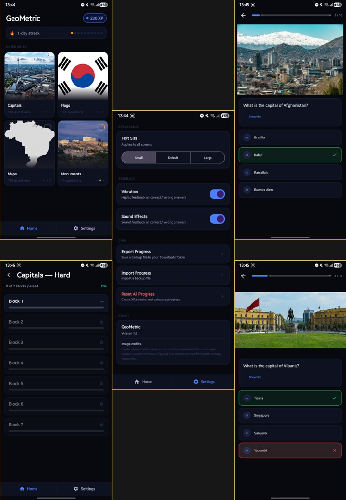

# GeoMetric

GeoMetric is an interactive educational Android app designed to test and improve geographical knowledge. This project was developed as a university assignment and is accompanied by an academic paper detailing its design and implementation.

## 🌍 Description

The app allows users to test their skills across four main geographical categories: **Capitals, Flags, Maps, and Monuments**. To keep the learning experience engaging, GeoMetric incorporates gamification elements such as Experience Points (XP), daily streaks, and progressive difficulty levels organized into "blocks". 

Whether you are trying to guess a country from its flag or identify a famous monument from a photo, the app provides a fun and intuitive way to learn geography.

## 📱 Screenshots

## ✨ Features

*   **4 Quiz Categories:** Choose between Capitals, Flags, Maps, and Monuments.
*   **Progressive Difficulty:** Questions are divided into blocks. You must pass a block to unlock the next, with difficulty increasing as you progress.
*   **Gamification:** Earn XP for correct answers, collect stars to track your mastery in each category, and maintain a daily learning streak!
*   **Interactive Media:** Support for image-based questions with pinch-to-zoom functionality.
*   **Hints System:** Get a little help on difficult questions.
*   **Fully Offline:** All questions, user progress, and statistics are stored locally on the device.
*   **Modern UI:** Clean, responsive interface built with Material Design principles.

## 🛠️ Tech Stack & Architecture

*   **Language:** Java
*   **Minimum SDK:** 29 (Android 10) | **Target SDK:** 36
*   **Local Storage:** Room Database (SQLite) for storing questions and user progress via DAOs (`QuestionDao`, `BlockProgressDao`).
*   **UI & Navigation:** Fragments, `ViewPager2`, and standard Android XML layouts.
*   **Key Libraries:**
    *   `com.google.android.material:material` for Material components.
    *   `androidx.core:core-splashscreen` for the modern Android splash screen.
    *   `com.github.chrisbanes:PhotoView` for interactive, zoomable images in quizzes.
    *   `com.google.code.gson:gson` for data handling.

## 🚀 Setup & Installation

**Option 1: Download the APK**
You can download the pre-compiled, ready-to-install `.apk` file directly from the [Releases](../../releases) section of this repository.

**Option 2: Build from source**
1.  Clone this repository to your local machine.
2.  Open the project in **Android Studio**.
3.  Sync the project with Gradle files.
4.  Build and run the app on an Android emulator or a physical device (Android 10+ required).

## 📚 Academic Context

This project was developed for a university course. The repository will be updated with a link to the accompanying academic paper once it is published, which contains all the sources, research, and technical design decisions.